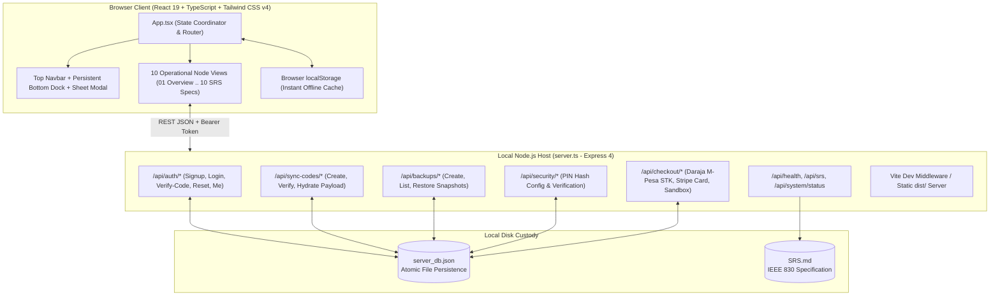

# Phase 2: Architecture Assessment — Mitior 2.0 (Agent B)

**Document Owner**: Agent B — Principal Software Architect

---

## 1. Current System Architecture Map

### 1.1 Runtime Topology
Mitior 2.0 uses a unified full-stack TypeScript architecture served from a single port (`http://localhost:3000` by default):

### 1.2 Component & State Management Analysis
- **State Root (`src/App.tsx`)**: Holds the canonical client state for `nodes` (`EngineNode[]`), `playbooks` (`Playbook[]`), `teamMembers` (`TeamMember[]`), `scorecard` (`ScorecardMetric[]`), `sprintPlan` (`SprintPlan`), `compass` (`ClarityCompass`), `enquiries` (`Enquiry[]`), and `activities` (`ActivityLog[]`).
- **Persistence Strategy**: Every state slice uses a `useEffect` hook to serialize updates to `localStorage` (`sOS_nodes`, `sOS_playbooks`, `sOS_team`, `sOS_scorecard`, `sOS_sprint`, `sOS_compass`, `sOS_enquiries`, `sOS_activities`), supplemented by server-side snapshot backups (`/api/backups`) and workspace sync codes (`/api/sync-codes`).

---

## 2. Identified Architectural Defects & Weaknesses

1. **Unauthenticated Password Reset Endpoint (`server.ts:753`)**:
   - `POST /api/auth/reset-password` accepted `{ email, password }` without validating whether the caller had verified their 6-digit recovery code or held an active session. Any caller knowing an email address could overwrite the account password.
2. **Plaintext Security PIN Persistence (`server.ts:1063`)**:
   - `POST /api/security/pin` wrote `pinHash: cleanPin` directly to `server_db.json` in plaintext.
3. **Unsalted SHA-256 Password Hashing (`server.ts:169`)**:
   - `hashPassword` used raw `crypto.createHash("sha256").update(password).digest("hex")` without a per-user cryptographic salt.
4. **Missing Authorization Header on Billing History (`src/components/SettingsView.tsx:516`)**:
   - `fetch("/api/checkout/history")` was called without `headers: getAuthHeaders()`, causing the server's `requireLoggedInUser` middleware to reject every billing history request with `401 Unauthorized`.
5. **Sync Code Payload Disconnect (`server.ts:873` & `WorkspaceSelectorView.tsx:50`)**:
   - Sync codes stored only metadata (`projectName`, `creatorName`, `description`) without the workspace state payload, preventing joining nodes from receiving the team's actual operational data.
6. **Non-Exportable Express App Instance for Automated Testing (`server.ts:207`)**:
   - `server.ts` immediately bound `app.listen(PORT)` inside `startServer()` without exporting the Express `app` or allowing dynamic port binding (`PORT=0`) for isolated integration testing.
7. **Typography & Scrollbar Ergonomics Drift (`index.html`, `src/index.css`)**:
   - Legacy fonts (`Space Grotesk` and `Manrope`) were imported via CSS `@import` (blocking render) instead of preloaded `<link>` tags in `index.html` for `Plus Jakarta Sans` and `Outfit` with `font-display: swap`.

---

## 3. Architectural Fitness Conclusion
The React 19 + Express 4 + Vite 6 single-repo architecture is well-suited to Mitior 2.0's local-first, autonomous operating model. No framework rewrite is warranted. Targeted architectural hardening of `server.ts`, `src/App.tsx`, `src/index.css`, and the component suite will achieve 100% SRS compliance while preserving fast local execution.
